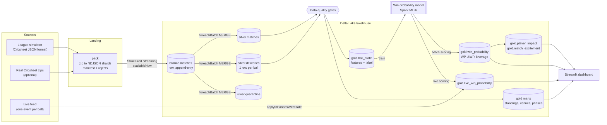

# 🏏 Cricket Win-Probability Lakehouse

**An end-to-end big data platform that turns ball-by-ball cricket data into live win probabilities and a
validated player-impact metric (Win Probability Added).**

[](https://github.com/pajiala99/cricket-winprob-lakehouse/actions/workflows/ci.yml)

`PySpark 4.2` · `Delta Lake 4.4` · `Spark Structured Streaming` · `Spark MLlib` · `Airflow 3` · `Streamlit` · `pytest` · `GitHub Actions`

Most portfolio pipelines stop at "load CSV, aggregate, plot". This one covers the whole lifecycle a data
platform team owns:

- **Medallion lakehouse** (bronze → silver → gold) on Delta Lake with exactly-once incremental ingestion
- **Idempotent upserts**: re-published match revisions replace old data atomically through Delta `MERGE`
- **Data-quality gates**: a declarative check framework blocks bad data before it reaches the next layer
- **Machine learning**: a ball-by-ball win-probability model with a time-based split, champion/challenger
  selection and calibration metrics
- **Real-time scoring**: Structured Streaming with per-match state (`applyInPandasWithState`) scores every
  ball as it happens, using the same feature code as training
- **A new metric, validated**: Win Probability Added (WPA) credits every player for how much they moved their
  team's chance of winning, and is checked against hidden ground-truth player skills
- **Operations**: DAG orchestrator with retries and run reports, Airflow DAGs, table compaction and Z-ordering,
  unit/integration/parity tests and CI

---

## Architecture



| Layer | Tables | What happens |
|---|---|---|
| **Landing** | `landing/packed/<batch>/part-*.ndjson` | Tens of thousands of small match files are packed into ~400-match shards (the small-files problem). A CRC manifest makes re-runs incremental; malformed files go to `landing/rejected/`. |
| **Bronze** | `bronze.matches` | Structured Streaming with `trigger(availableNow=True)` appends raw documents under an explicit schema. The checkpoint gives exactly-once ingestion; the same job serves backfill and daily increments. |
| **Silver** | `silver.matches`, `silver.deliveries`, `silver.players`, `silver.quarantine` | Nested `innings → overs → deliveries` exploded to one row per ball. Venue-name variants and franchise renames are normalised, players keyed by registry ID (names collide), and the newest revision wins through atomic `MERGE`s. |
| **Gold** | `ball_state`, `win_probability`, `player_impact`, `match_excitement`, `team_standings`, `venue_stats`, `season_scoring`, `*_phase_stats` | Window-function features (running score, last-30-ball momentum, as-of venue par with no future leakage), model scores, WPA, leverage index and analytics marts. |
| **Quality** | `quality.dq_results` | Every check result from every run, for trend analysis and auditing. |

---

## Results (full local run on a 10-core laptop)

<!-- RESULTS:START -->
| | |
|---|---|
| **Volume** | 7,009 nested JSON match documents → **1,667,611 ball-by-ball rows** (1,936 players, 15 seasons, 8 competitions) |
| **Full clean build** | 12 orchestrated tasks in **180 s** (Spark local mode); model training is the largest step at 69 s |
| **Incremental day-2 load** | 205 documents (109 new matches + 96 corrected revisions) MERGEd; **0 matches lost balls, 0 duplicate ball keys** |
| **Data quality** | 12/12 silver and 7/7 gold checks pass; 8 truncated files rejected at landing |
| **Model on unseen 2025–26 seasons** | Champion gradient-boosted trees: log loss **0.556**, Brier skill score **23.8%**, AUC **0.777**, calibration error **1.8 pp** |
| **Challenger** | Logistic regression: log loss 0.558, AUC 0.772, calibration error 2.1 pp (lost on validation log loss, 0.562 vs 0.555) |
| **Accuracy as the match unfolds** | 58.5% after the first 5 overs → **83.7%** in the last 5 overs of a chase |
| **Tests** | 14 pytest tests (unit, Delta integration, streaming/batch parity) pass; ruff clean |

**Does WPA measure real skill?** Spearman rank correlation between each metric and the simulator's hidden
player skill (1 = perfect ranking):

| Ranking players by… | ρ |
|---|---|
| Batters: **WPA per ball** | **0.36** |
| Batters: strike rate | 0.26 |
| Bowlers: wickets per ball | 0.69 |
| Bowlers: **WPA per ball** | **0.39** |
| Bowlers: economy rate | 0.12 |
| Clutch ability (high-leverage WPA beyond ordinary-ball WPA): batters / bowlers | **0.37 / 0.39** |

WPA beats strike rate and economy because it knows the game situation: a finisher's strike rate is inflated
by *when* he bats, and a death bowler's economy by *when* he bowls. Wickets per ball still ranks bowlers best,
so impact metrics complement traditional statistics rather than replace them. Clutch ability is detectable
but noisy (ρ ≈ 0.4). The validation step also exposed a flaw in the simulator itself: captains used up their
best bowlers early, so wickets correlated *negatively* with skill. Captains now keep their strike bowlers'
overs for the death.
<!-- RESULTS:END -->

---

## Quickstart

Requirements: Python 3.11, Java 17, [uv](https://github.com/astral-sh/uv) (or pip).

```bash
make setup        # virtualenv + dependencies
make pipeline     # clean build: simulate -> pack -> bronze -> silver -> DQ -> features/marts -> train -> impact -> DQ -> validate -> optimize
make dashboard    # http://localhost:8501
```

Live demo (two terminals, dashboard open on the **Live** tab):

```bash
make live-score   # terminal 1: Structured Streaming scorer
make live-feed    # terminal 2: a brand-new match, one ball every 0.5 s
```

Incremental day-2 load (new matches plus re-published corrections):

```bash
make incremental
```

Run a subset or resume: `python -m cricklake.orchestrate --only train impact`, or `--from features`.

Airflow 3 (separate virtualenv, pinned with Airflow's official constraints). `airflow-test` runs the daily DAG once,
end to end, without a scheduler. Locally all 9 tasks succeeded in about 3 minutes.

```bash
make airflow-setup
make airflow-test
```

---

## Engineering decisions worth talking about

**1. Simulated data in the exact Cricsheet schema.** cricsheet.org blocks automated downloads, so the project
ships a probabilistic T20 league simulator: phase-dependent scoring, era inflation, venue and dew effects,
chase pressure, super overs, rain-reduced (D/L) chases and no-results. It emits the exact Cricsheet JSON
format, so real downloads run through the same pipeline unchanged. It also deliberately injects messy data:
truncated files, venue-name variants, franchise renames, duplicate player names across leagues, umpire
miscounts and re-published revisions.

**2. The simulator makes the metric testable.** Every simulated player has hidden batting, bowling and
*clutch* skills. With real data nobody knows whether an impact metric is right; here the pipeline's WPA is
scored against the truth (`ml/validate_wpa.py`).

**3. One streaming code path for batch and incremental.** Bronze and silver are Structured Streaming jobs run
with `availableNow`. Backfill, daily increments and replays are the same code, and checkpoints provide
exactly-once processing.

**4. Revision-safe upserts, and a bug the tests caught.** Silver `MERGE`s balls with
`WHEN NOT MATCHED BY SOURCE DELETE` scoped to the revised matches, so a corrected match replaces its old balls
atomically. The integration test first failed with *zero* balls left. The micro-batch was cached, but its plan
still read `silver.matches`. When the job wrote to that table, Spark's cache invalidation re-evaluated the
batch, the "newer revision" filter came back empty, and the delete clause removed everything. The fix is
`localCheckpoint()` (a true snapshot), plus writing balls before the match row so the match row acts as the
commit marker and a crash in between replays safely.

**5. Train/serve parity by construction.** The live scorer keeps per-match running totals in Spark state and
then calls the *same* `add_state_features` function the batch pipeline uses. A test replays whole matches
through the streaming state machine and asserts every model feature equals the batch window-function value.

**6. Honest ML evaluation.** The split is by time (train ≤ 2023, validate 2024, test 2025+), so the model is
judged on seasons it never saw. Probabilities are graded with log loss, Brier skill score and expected
calibration error, not just accuracy. Gradient-boosted trees and logistic regression compete, and the winner
is chosen on validation log loss. Finished chases are pinned to 1 / 0.5 / 0, because certainty should not be
left to a model.

**7. WPA and leverage.** Each ball's ΔWP is credited to the batter (+) and debited from the bowler (−).
Leverage index is how much win probability typically moves in that game situation relative to an average
ball; "clutch" WPA counts only balls with leverage ≥ 2.

---

## Data quality

Checks are declared in `src/cricklake/quality/checks.py` (`expect`, `unique`, `foreign_key` or custom SQL,
each with a severity and a tolerance):

- primary keys unique (matches, balls, player-seasons); balls reference existing matches
- `runs_total = runs_batter + runs_extras`; winners are participants; accepted result types
- legal balls per over ≤ balls per over (warning, tolerance 1%: umpires miscount)
- a chase never overshoots the target by more than one hit; every finished chase's WP ends at 0, 0.5 or 1

A failed `error` check raises `DataQualityError`, and the orchestrator skips every downstream task.

---

## Project layout

```
conf/pipeline.yaml                  paths, Spark, model and streaming settings
src/cricklake/
  ingest/simulator.py               T20 league simulator (Cricsheet format, latent skills)
  ingest/pack.py                    zip -> NDJSON shards, manifest, rejects
  schemas.py                        explicit data contracts
  pipelines/bronze.py               streaming ingestion to Delta
  pipelines/silver.py               explode, normalise, MERGE, quarantine
  pipelines/features.py             ball_state features (shared with streaming)
  pipelines/marts.py                standings + NRR, venues, phases, scoring trends
  pipelines/impact.py               win probability, WPA, leverage, excitement
  ml/train.py                       GBT vs logistic regression, model card
  ml/validate_wpa.py                WPA vs ground truth
  streaming/live_feed.py            publishes a new match ball by ball
  streaming/state.py                per-match running totals (pure Python)
  streaming/live_scoring.py         Structured Streaming scorer
  quality/checks.py                 data-quality framework + suites
  orchestrate.py                    DAG runner: retries, run reports
orchestration/airflow/dags/         daily incremental + weekly retrain DAGs
dashboard/app.py                    Streamlit app (reads Delta via delta-rs, no Spark)
tests/                              simulator, packer, silver MERGE, DQ, streaming/batch parity
```

---

## Using real Cricsheet data

1. In a browser, download a zip from <https://cricsheet.org/downloads/> (for example `ipl_json.zip` or
   `t20s_json.zip`) into `data/landing/downloads/real/`.
2. Build the lakehouse from it (there is no ground truth for real players, so validation is skipped):

```bash
.venv/bin/python -m cricklake.orchestrate --fresh --skip simulate validate_wpa --pattern "real/*.zip"
```

Check Cricsheet's licence terms before redistributing their data.

---

## Testing

```bash
make test   # local Spark + Delta, temporary lakehouses
make lint
```

| Test | Guards |
|---|---|
| `test_simulator.py` | probabilities valid, skills move outcomes, matches internally consistent, deterministic seeds |
| `test_pack.py` | incremental + idempotent packing, malformed files rejected, revisions re-emitted |
| `test_silver.py` | every ball exploded, venue normalisation, revision replaces balls atomically |
| `test_features_parity.py` | overs notation, chase maths, **streaming features == batch features** |
| `test_quality.py` | blocking vs warning checks, recorded results, streaming state window + JSON round trip, DAG compiles |

## Limitations and next steps

- The data is simulated. The scoring patterns are plausible T20 cricket, but they are not calibrated to real
  leagues.
- Spark runs in local mode. The same jobs would run on Databricks, EMR or Dataproc by pointing paths at object
  storage.
- The live feed uses a file-based inbox. In production it would be Kafka, and only the `readStream` source line
  changes.
- The Airflow DAGs compile but were not executed in an Airflow deployment in this repo.
- Model ideas: batting-lineup strength, bowler overs remaining, team form.
