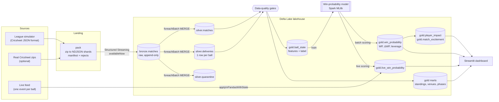

# 🏏 Cricket Win-Probability Lakehouse

**An end-to-end big data platform that turns ball-by-ball cricket data into live win probabilities and a
validated player-impact metric (Win Probability Added).**

[](https://github.com/pajiala99/cricket-winprob-lakehouse/actions/workflows/ci.yml)

**Live demo: [what does the model make of this chase?](https://pajiala99.github.io/#demo-cricket)** Sliders for overs
left, wickets in hand and runs needed, showing the real-data model's own predictions for 39,920 chase states. It runs in
the browser, from a file Spark precomputed (see the [model card](#model-card-real-data-champion)).

**On real data:** 8,852 men's and women's T20 matches (February 2005 to April 2026, 2,026,949 balls). On 2025–26
matches the model never saw, it scores AUC **0.844**, Brier skill score **35.7%** and calibration error **1.3 pp**
([details](#real-cricsheet-data)). The simulated league below adds what real data can't: players with hidden skills,
to check the impact metric against.

`PySpark 4.2` · `Delta Lake 4.4` · `Spark Structured Streaming` · `Spark MLlib` · `Airflow 3` · `Streamlit` · `pytest` · `GitHub Actions`

Most portfolio pipelines stop at "load CSV, aggregate, plot". This one covers the whole lifecycle a data
platform team owns:

- **Medallion lakehouse** (bronze → silver → gold) on Delta Lake with exactly-once incremental ingestion
- **Idempotent upserts**: re-published match revisions replace old data atomically through Delta `MERGE`
- **Data-quality gates**: a declarative check framework blocks bad data before it reaches the next layer
- **Machine learning**: a ball-by-ball win-probability model with a time-based split, champion/challenger
  selection and calibration metrics
- **Real-time scoring**: Structured Streaming with per-match state (`applyInPandasWithState`) scores every
  ball as it happens, using the same feature code as training
- **A new metric, validated**: Win Probability Added (WPA) credits every player for how much they moved their
  team's chance of winning, and is checked against hidden ground-truth player skills
- **Operations**: DAG orchestrator with retries and run reports, Airflow DAGs, table compaction and Z-ordering,
  unit/integration/parity tests and CI

---

## Architecture



| Layer | Tables | What happens |
|---|---|---|
| **Landing** | `landing/packed/<batch>/part-*.ndjson` | Tens of thousands of small match files are packed into ~400-match shards (the small-files problem). A CRC manifest makes re-runs incremental; malformed files go to `landing/rejected/`. |
| **Bronze** | `bronze.matches` | Structured Streaming with `trigger(availableNow=True)` appends raw documents under an explicit schema. The checkpoint gives exactly-once ingestion; the same job serves backfill and daily increments. |
| **Silver** | `silver.matches`, `silver.deliveries`, `silver.players`, `silver.quarantine` | Nested `innings → overs → deliveries` exploded to one row per ball. Venue-name variants and franchise renames are normalised, players keyed by registry ID (names collide), and the newest revision wins through atomic `MERGE`s. |
| **Gold** | `ball_state`, `win_probability`, `player_impact`, `match_excitement`, `team_standings`, `venue_stats`, `season_scoring`, `*_phase_stats` | Window-function features (running score, last-30-ball momentum, as-of venue par with no future leakage), model scores, WPA, leverage index and analytics marts. |
| **Quality** | `quality.dq_results` | Every check result from every run, for trend analysis and auditing. |

---

## Results on the simulated league (full local run on a 10-core laptop)

Real-data results are under [Real Cricsheet data](#real-cricsheet-data).

<!-- RESULTS:START -->
| | |
|---|---|
| **Volume** | 7,009 nested JSON match documents → **1,667,611 ball-by-ball rows** (1,936 players, 15 seasons, 8 competitions) |
| **Full clean build** | 12 orchestrated tasks in **183 s** (Spark local mode); model training is the largest step at 85 s |
| **Incremental day-2 load** | 205 documents (109 new matches + 96 corrected revisions) MERGEd; **0 matches lost balls, 0 duplicate ball keys** |
| **Data quality** | 12/12 silver and 7/7 gold checks pass; 8 truncated files rejected at landing |
| **Model on unseen 2025–26 seasons** | Champion gradient-boosted trees: log loss **0.555**, Brier skill score **23.9%**, AUC **0.777**, calibration error **1.9 pp** |
| **Challenger** | Logistic regression: log loss 0.558, AUC 0.772, calibration error 2.0 pp (lost on validation log loss, 0.562 vs 0.556) |
| **Accuracy as the match unfolds** | 58.7% after the first 5 overs → **83.8%** in the last 5 overs of a chase |
| **Tests** | 19 pytest tests (unit, Delta integration, streaming/batch parity, training reproducibility) pass; ruff clean |

**Does WPA measure real skill?** Spearman rank correlation between each metric and the simulator's hidden
player skill (1 = perfect ranking):

| Ranking players by… | ρ |
|---|---|
| Batters: **WPA per ball** | **0.39** |
| Batters: strike rate | 0.26 |
| Bowlers: wickets per ball | 0.69 |
| Bowlers: **WPA per ball** | **0.35** |
| Bowlers: economy rate | 0.12 |
| Clutch ability (high-leverage WPA beyond ordinary-ball WPA): batters / bowlers | **0.32 / 0.38** |

WPA beats strike rate and economy because it knows the game situation: a finisher's strike rate is inflated
by *when* he bats, and a death bowler's economy by *when* he bowls. Wickets per ball still ranks bowlers best,
so impact metrics complement traditional statistics rather than replace them. Clutch ability is detectable
but noisy (ρ 0.32 for batters, 0.38 for bowlers). The validation step also exposed a flaw in the simulator itself: captains used up their
best bowlers early, so wickets correlated *negatively* with skill. Captains now keep their strike bowlers'
overs for the death.

These figures come from a fresh build on 6 Nov 2026, and they are reproducible: three fresh builds gave the same
trees and the same WPA correlations to every digit. Earlier versions were not. Spark's boosted trees sample rows
partition by partition, so the same data in another file layout, or on a laptop with a different number of cores,
trained a different model (test AUC from 0.775 to 0.780 on one table). Training now puts the rows in a fixed order
first. The rankings above held in every build measured.
<!-- RESULTS:END -->

---

## Quickstart

Requirements: Python 3.11, Java 17, [uv](https://github.com/astral-sh/uv) (or pip).

```bash
make setup        # virtualenv + dependencies
make pipeline     # clean build: simulate -> pack -> bronze -> silver -> DQ -> features/marts -> train -> impact -> DQ -> validate -> optimize
make dashboard    # http://localhost:8501
```

Live demo (two terminals, dashboard open on the **Live** tab):

```bash
make live-score   # terminal 1: Structured Streaming scorer
make live-feed    # terminal 2: a brand-new match, one ball every 0.5 s
```

Incremental day-2 load (new matches plus re-published corrections):

```bash
make incremental
```

Run a subset or resume: `python -m cricklake.orchestrate --only train impact`, or `--from features`.

Airflow 3 (separate virtualenv, pinned with Airflow's official constraints). `airflow-test` runs the daily DAG once,
end to end, without a scheduler. Locally all 9 tasks succeeded in about 3 minutes.

```bash
make airflow-setup
make airflow-test
```

---

## Engineering decisions worth talking about

**1. Simulated data in the exact Cricsheet schema.** cricsheet.org blocks automated downloads, so the project
ships a probabilistic T20 league simulator: phase-dependent scoring, era inflation, venue and dew effects,
chase pressure, super overs, rain-reduced (D/L) chases and no-results. It emits the exact Cricsheet JSON
format, so real downloads run through the same pipeline unchanged. It also deliberately injects messy data:
truncated files, venue-name variants, franchise renames, duplicate player names across leagues, umpire
miscounts and re-published revisions.

**2. The simulator makes the metric testable.** Every simulated player has hidden batting, bowling and
*clutch* skills. With real data nobody knows whether an impact metric is right; here the pipeline's WPA is
scored against the truth (`ml/validate_wpa.py`).

**3. One streaming code path for batch and incremental.** Bronze and silver are Structured Streaming jobs run
with `availableNow`. Backfill, daily increments and replays are the same code, and checkpoints provide
exactly-once processing.

**4. Revision-safe upserts, and a bug the tests caught.** Silver `MERGE`s balls with
`WHEN NOT MATCHED BY SOURCE DELETE` scoped to the revised matches, so a corrected match replaces its old balls
atomically. The integration test first failed with *zero* balls left. The micro-batch was cached, but its plan
still read `silver.matches`. When the job wrote to that table, Spark's cache invalidation re-evaluated the
batch, the "newer revision" filter came back empty, and the delete clause removed everything. The fix is
`localCheckpoint()` (a true snapshot), plus writing balls before the match row so the match row acts as the
commit marker and a crash in between replays safely.

**5. Train/serve parity by construction.** The live scorer keeps per-match running totals in Spark state and
then calls the *same* `add_state_features` function the batch pipeline uses. A test replays whole matches
through the streaming state machine and asserts every model feature equals the batch window-function value.

**6. Honest ML evaluation.** The split is by time (train ≤ 2023, validate 2024, test 2025+), so the model is
judged on seasons it never saw. Probabilities are graded with log loss, Brier skill score and expected
calibration error, not just accuracy. Gradient-boosted trees and logistic regression compete, and the winner
is chosen on validation log loss. Finished chases are pinned to 1 / 0.5 / 0, because certainty should not be
left to a model.

**7. WPA and leverage.** Each ball's ΔWP is credited to the batter (+) and debited from the bowler (−).
Leverage index is how much win probability typically moves in that game situation relative to an average
ball; "clutch" WPA counts only balls with leverage ≥ 2.

---

## Data quality

Checks are declared in `src/cricklake/quality/checks.py` (`expect`, `unique`, `foreign_key` or custom SQL,
each with a severity and a tolerance):

- primary keys unique (matches, balls, player-seasons); balls reference existing matches
- `runs_total = runs_batter + runs_extras`; winners are participants; accepted result types
- legal balls per over ≤ balls per over (warning, tolerance 1%: umpires miscount)
- a chase never overshoots the target by more than one hit; every finished chase's WP ends at 0, 0.5 or 1

A failed `error` check raises `DataQualityError`, and the orchestrator skips every downstream task.

---

## Project layout

```
conf/pipeline.yaml                  paths, Spark, model and streaming settings
src/cricklake/
  ingest/simulator.py               T20 league simulator (Cricsheet format, latent skills)
  ingest/pack.py                    zip -> NDJSON shards, manifest, rejects
  schemas.py                        explicit data contracts
  pipelines/bronze.py               streaming ingestion to Delta
  pipelines/silver.py               explode, normalise, MERGE, quarantine
  pipelines/features.py             ball_state features (shared with streaming)
  pipelines/marts.py                standings + NRR, venues, phases, scoring trends
  pipelines/impact.py               win probability, WPA, leverage, excitement
  ml/train.py                       GBT vs logistic regression, model card
  ml/validate_wpa.py                WPA vs ground truth
  ml/export_grid.py                 the model's predictions over 39,920 chase states, for the live demo
  streaming/live_feed.py            publishes a new match ball by ball
  streaming/state.py                per-match running totals (pure Python)
  streaming/live_scoring.py         Structured Streaming scorer
  quality/checks.py                 data-quality framework + suites
  orchestrate.py                    DAG runner: retries, run reports
orchestration/airflow/dags/         daily incremental + weekly retrain DAGs
dashboard/app.py                    Streamlit app (reads Delta via delta-rs, no Spark)
tests/                              simulator, packer, silver MERGE, DQ, streaming/batch parity
```

---

## Real Cricsheet data

The same pipeline runs on real ball-by-ball data through a separate profile (`conf/real.yaml`) with its own
lakehouse under `data/real/`, so the simulated build stays untouched. cricsheet.org blocks automated downloads,
so `real-download` fetches the match files from a public Hugging Face mirror of Cricsheet and packages them
exactly like the official per-competition zips. The mirror rate-limits anonymous downloads, so the first run
takes a while.

```bash
make real-download    # IPL, T20 internationals, BBL, WBBL, PSL, CPL, SA20, ILT20, MLC
make real-pipeline    # full build; WPA validation is skipped because real players have no ground truth
make real-dashboard
```

Replay a real match through the streaming scorer, for example the latest final (two terminals):

```bash
make real-live-score
make real-live-feed
```

**Results on real data.** The build covers 8,852 men's and women's matches from February 2005 to April 2026
(2,026,949 balls). The model trains on matches up to 2023, is tuned on 2024 and tested on 2025–26. The full
rebuild takes about 4 minutes, and all 19 data-quality checks pass.

| On unseen 2025–26 matches | Gradient-boosted trees (champion) | Logistic regression |
|---|---|---|
| Log loss | **0.477** | 0.500 |
| Brier skill score | **35.7%** | 31.9% |
| AUC | **0.844** | 0.825 |
| Calibration error | **1.3 pp** | 1.3 pp |

Accuracy climbs from 61% early in the first innings to 90% in the last five overs of a chase. These scores
come from a different dataset than the simulated results above, so the two sets aren't directly comparable.

Real data also exposed three problems the simulation never produced:

- **Rain rules.** The silver gate blocked 8 IPL, CPL and BBL chases that passed their target by more than one
  hit. They were rain-affected games, where Cricsheet records the D/L par score at the moment play stopped. The
  rule was wrong, not the data: it now skips D/L games, and win probability pins a won chase only on the
  innings' final ball.
- **Unnamed events.** The gold gate flagged 1,459 "duplicate" player-seasons. 66 internationals have no series
  name, and those NULL keys both split the player-impact join and fooled `count(DISTINCT …)`. Silver now names
  such events, and uniqueness checks are NULL-safe.
- **Nested files.** The mirror stores T20 internationals in `part_*` subfolders with repeated files. Packaging
  only the top level would have silently dropped about 3,000 matches; it now searches subfolders and keeps one
  file per match.

Data: [Cricsheet](https://cricsheet.org). Check Cricsheet's licence terms before redistributing the data.

---

## Model card (real-data champion)

| | |
|---|---|
| **Predicts** | The probability that the batting side wins, after every ball of a 20-over match (men's and women's) |
| **Model** | Spark MLlib gradient-boosted trees (80 trees, depth 6, step 0.1, subsampling 0.8, rows in a fixed order so every rebuild gives the same trees), chosen over logistic regression on validation log loss |
| **Data** | 8,852 real Cricsheet matches, February 2005 to April 2026. Split by date: train to 2023 (1,378,362 balls), validate on 2024 (290,249), test on 2025–26 (355,308) |
| **Inputs** | 16 match-state features: score, wickets, balls left, run rates, runs and wickets in the last 30 balls, the venue's as-of par score, target, runs needed, required rate, rate gap, par gap, a women's-match flag |
| **Test results** | Log loss 0.477, Brier skill score 35.7%, AUC 0.844, calibration error 1.3 pp, accuracy 74.9% (61% early in the first innings, 90% in the last five overs of a chase) |

**Limits**

- It knows the match state, not the teams: no batting line-up, players, form or toss.
- A tree ensemble predicts in steps, so one run can move the probability by several points, and ΔWP inherits
  those jumps.
- The demo needs inputs a slider can't set. `python -m cricklake.ml.export_grid` fills them with the median of real
  training chases at the same over with the same wickets down, and marks states that fewer than 25 real chases came
  near, where the model is extrapolating.

**Fixed: a feature flaw the live demo exposed.** `rate_gap` (required rate minus run rate) used to be 0.0 for every
first-innings ball: 727,684 training rows, against 1,000 chase balls that sat exactly on the required rate. The trees
learned "exactly 0" as a first-innings signal, so the demo's line dipped wherever a chase was exactly on the required
rate. First-innings balls now get 40, which no chase can reach: the required rate is capped at 36 and the run rate is
never negative. (−1, the value `required_rate` uses, would have collided with 334 chase balls running exactly one run
an over ahead.) After retraining:

| | Before | After (current model) |
|---|---|---|
| 10 overs left, 70/3, 70 needed, at a rate gap of −0.01 / 0 / +0.01 | 81.2% / 65.1% / 75.4% | 85.8% / 85.8% / 85.8% |
| Demo states exactly on the required rate that dip below both neighbours | 59 of 91 | 3 of 91 |
| 215 test-season chase balls exactly on the required rate (the chase won 63.7%): mean prediction | 53.2% | 62.1% |
| Test log loss, Brier skill score, AUC | 0.476, 35.9%, 0.845 | 0.477, 35.7%, 0.844 |
| Test calibration error, accuracy | 0.8 pp, 75.1% | 1.3 pp, 74.9% |

The overall scores barely move because only about 1 test ball in 1,650 sits exactly on the required rate. Calibration
error rose on the test seasons but not on the validation season (1.07 to 1.05 pp). The After column is the
current model, retrained on 6 Nov 2026 on a fixed row order (see the simulated results); that retrain alone moved test
AUC by 0.001 and the on-the-rate prediction from 63.3% to 62.1%, and left the three dips each under 1.5 points.

---

## Testing

```bash
make test   # local Spark + Delta, temporary lakehouses
make lint
```

| Test | Guards |
|---|---|
| `test_simulator.py` | probabilities valid, skills move outcomes, matches internally consistent, deterministic seeds |
| `test_pack.py` | incremental + idempotent packing, malformed files rejected, revisions re-emitted |
| `test_silver.py` | every ball exploded, venue normalisation, revision replaces balls atomically |
| `test_features_parity.py` | overs notation, chase maths, a first-innings rate gap no chase can reach, **streaming features == batch features** |
| `test_quality.py` | blocking vs warning checks, recorded results, streaming state window + JSON round trip, DAG compiles |

## Limitations and next steps

- The headline results and the WPA validation use simulated data: plausible T20 cricket, but not calibrated to
  real leagues. The real-data profile runs the same pipeline on real matches, but real players have no ground
  truth, so WPA can't be validated there.
- Spark runs in local mode. The same jobs would run on Databricks, EMR or Dataproc by pointing paths at object
  storage.
- The live feed uses a file-based inbox. In production it would be Kafka, and only the `readStream` source line
  changes.
- Airflow was exercised with `airflow dags test` (the daily DAG, 9 of 9 tasks) rather than a long-running
  scheduler and executor.
- Model ideas: batting-lineup strength, bowler overs remaining, team form, and smoother tree outputs (monotonic
  constraints) so ΔWP jumps less.

---

**Hardik Pajiala** · [LinkedIn](https://linkedin.com/in/hardik-pajiala) · [Portfolio](https://pajiala99.github.io) · [GitHub](https://github.com/pajiala99)
